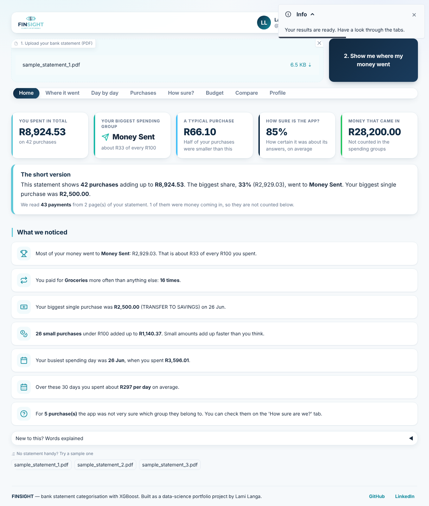
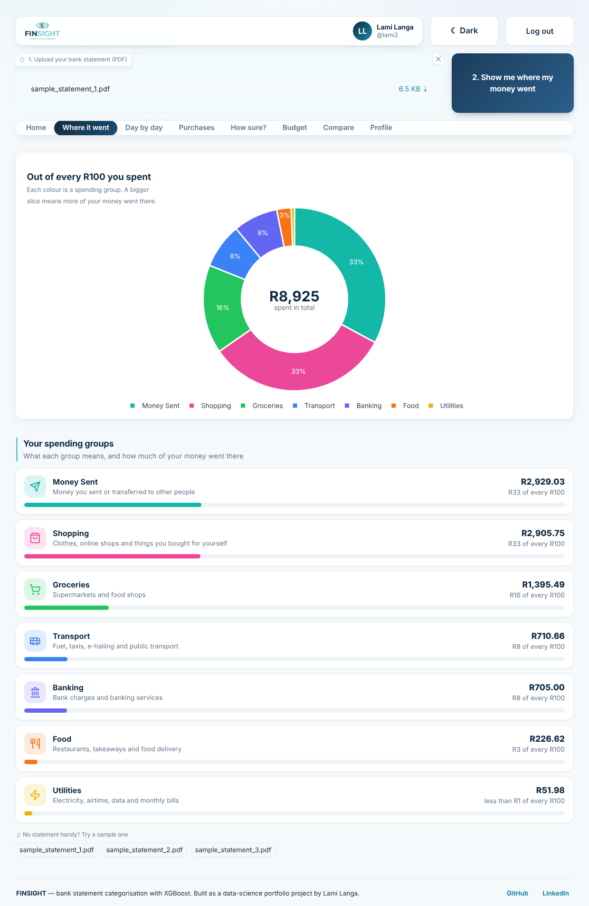
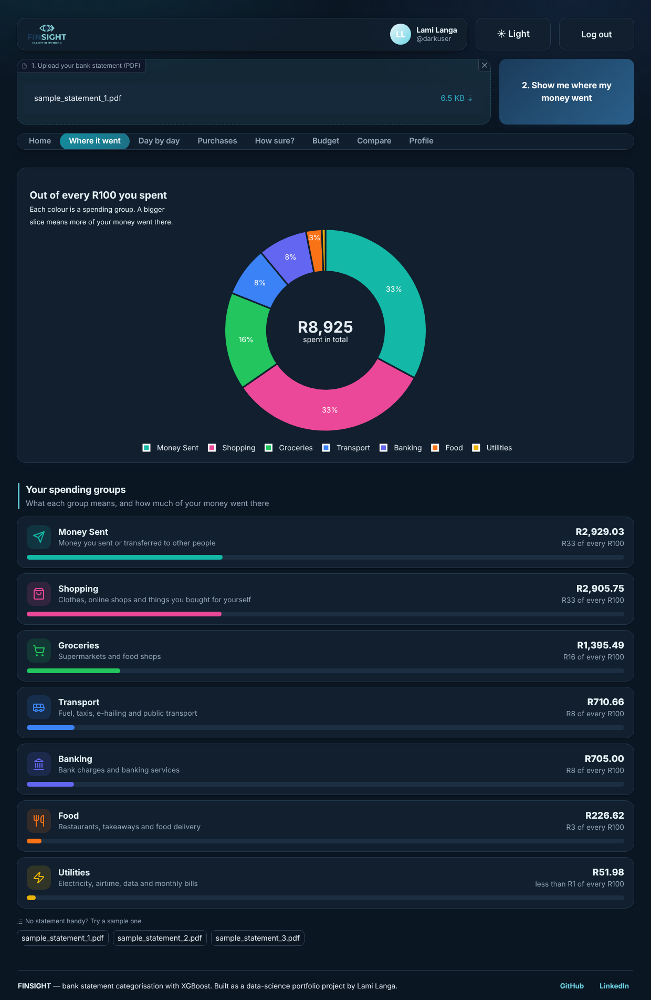
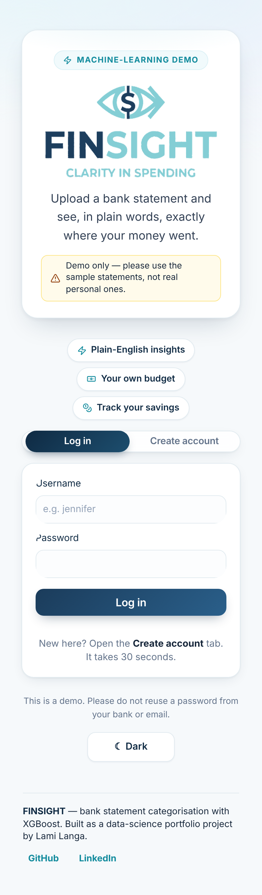

# FINSIGHT — Bank Statement Analyser

Upload a South African bank statement as a PDF. FINSIGHT reads every transaction,
sorts each one into a spending category using a trained XGBoost classifier, and
explains the result in plain English — then compares it against a budget you set.

**[Live demo →](https://finsight-evkz.onrender.com)**  ·  *(free hosting: the first load after a quiet spell takes ~1 minute to wake)*

> Demo only. The app ships with sample statements; please don't upload a real
> personal bank statement to a public demo.



---

## Why this exists

Most people can't answer "where did my money actually go last month?" without
sitting down with a statement and a calculator. Bank apps categorise some
transactions, but South African merchant descriptors are messy — `VISA DDA PUR
449215 FNB EWALLET MAT 1036 * GP` is not obviously a transfer.

FINSIGHT does that categorisation automatically and, importantly, **tells you how
confident it is**, so a wrong guess can be spotted rather than quietly believed.

## What it does

| Stage | Approach |
|---|---|
| Read the PDF | `pdfplumber` text extraction, with each amount cross-checked against the statement's own running balance |
| Feature engineering | Date parts, inferred original purchase date, days-to-process, time of day, online-merchant flag, derived transaction type |
| Categorise | TF-IDF over the description, stacked with scaled numeric features, into a multi-class XGBoost model |
| Confidence | Top-1 probability plus the runner-up category; anything under 50% is flagged for review |
| Explain | Plain-language insights and Plotly charts — category donut, daily stacked spend, confidence by category |
| Budget | Per-category plan, planned-vs-actual, what overspending cost, progress to a savings goal |
| Accounts | SQLite with PBKDF2-hashed passwords, saved budgets, analysis history |

**Stack:** Python · XGBoost · scikit-learn · pandas · Gradio · Plotly · pdfplumber · DuckDB · SQLite

<table>
  <tr>
    <td></td>
    <td></td>
  </tr>
</table>

---

## Two ways in

**The web app** (`app.py`) handles one statement at a time, interactively.

**The batch pipeline** (`pipeline/`) handles a folder of them, loading the results
into a DuckDB warehouse you can query with SQL:

```bash
python -m pipeline.run                 # process data/statements_inbox
python -m pipeline.run --dry-run       # parse and validate, write nothing
python -m pipeline.run --full-refresh  # reprocess what's already loaded
```

30 sample statements are included, so it runs out of the box: 1 210 transactions
across 30 statements in about five seconds.

### Pipeline architecture

```
data/statements_inbox/*.pdf
        │
        ▼   extract.py       reuses pdf_extraction.py
   BRONZE   raw rows, untouched, with lineage (file, sha256, page, line_no)
        │                    → warehouse/bronze/*.parquet
        ▼   transform.py     reuses finsight_core.py — the same model as the app
   SILVER   typed and cleaned; inflow/outflow split; category + confidence
        │                    → warehouse/silver/*.parquet
        ▼   quality.py       8 checks; fatal ones abort before the warehouse is touched
    GOLD    star schema + marts
                             → warehouse/finsight.duckdb
```

The model and feature engineering live in `finsight_core.py`, imported by both the
app and the pipeline. There is one implementation of "how a transaction becomes a
category", so the interactive app and the warehouse can't drift apart.

### Warehouse

| Table | Grain |
|---|---|
| `fct_transaction` | one row per transaction line |
| `dim_date` | one row per calendar day, with weekday/weekend flags |
| `dim_category` | one row per spending group |
| `dim_statement` | one row per statement file, with period and row count |
| `run_log` | one row per pipeline run: counts, status, warnings |

Plus views for reporting: `mart_spend_by_category`, `mart_monthly_spend`,
`mart_statement_summary`, `mart_review_queue`, `mart_weekday_spend`.

```sql
-- transactions the model was least sure about
SELECT * FROM mart_review_queue LIMIT 20;

-- month-on-month movement in one category
SELECT year, month_name, total_zar
FROM mart_monthly_spend
WHERE category = 'Groceries'
ORDER BY year, month;
```

### Engineering decisions

- **Idempotent loads.** Statements are keyed by a SHA-256 of their contents, rows by
  a deterministic `txn_id` of `statement_id:page:line_no`. Running the pipeline three
  times leaves 1 210 rows, not 3 630.
- **A bad file doesn't sink the batch.** An unreadable PDF is logged with a reason;
  the rest still load.
- **Income is not a spending category.** Only outflows go through the model; inflows
  are labelled `Income` and excluded from every spending mart.
- **Low confidence is surfaced, not hidden.** Rows under 50% go to
  `mart_review_queue` rather than being silently trusted. On the sample data that's
  about 7% of transactions.
- **Quality gate before the load.** Duplicate keys, null dates, non-positive amounts
  and uncategorised rows abort the run. Balance-check failures and low confidence
  warn and are recorded in `run_log`.

```bash
pytest -q   # 14 tests covering the transform rules, quality gates and idempotency
```

---

## Running it locally

Requires Python 3.10+ (tested on 3.13).

```bash
git clone https://github.com/lamidoesIT/finsight.git
cd finsight
python -m venv .venv
source .venv/bin/activate        # Windows: .venv\Scripts\Activate.ps1
pip install -r requirements.txt       # app only
pip install -r requirements-dev.txt   # + pipeline and tests
python app.py                         # http://127.0.0.1:7860
```

Set `FINSIGHT_SHARE=1` for a temporary public Gradio link.

### Deploying

`render.yaml` deploys the app to [Render](https://render.com)'s free tier as-is:
New → Blueprint, point it at this repo. The app reads `PORT` from the
environment and binds `0.0.0.0` when it is set, so it runs unchanged locally
and in the cloud.

Measured footprint: **326 MB idle, 386 MB peak** during an analysis — inside
Render's 512 MB free allowance.



---

## Credits

FINSIGHT began as an Eduvos BSc IT capstone project. The trained model, PDF
extraction and analysis logic are the group's work — the original Space is
[JenniferAnnKok/FINSIGHT](https://huggingface.co/spaces/JenniferAnnKok/FINSIGHT).

This repository is my work on top of that: the interface redesign (including dark
mode and mobile layout), the shared `finsight_core` refactor, the batch ETL
pipeline and DuckDB warehouse, the test suite, and deployment packaging.

Built by **Lami Langa** — [GitHub](https://github.com/lamidoesIT) ·
[LinkedIn](https://www.linkedin.com/in/lami-langa-a063272b5)

## License

MIT
